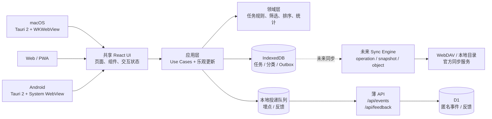
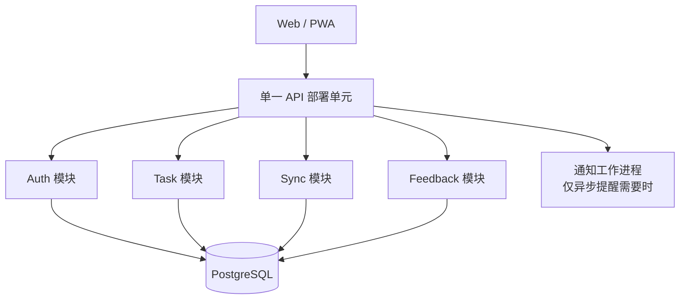

# QuietDo · 轻作系统架构设计方案

> **文档版本** v2.3 | **更新日期** 2026-07-16 | **状态** macOS + Android MVP 已交付
> **架构主线** 本地优先原生客户端 → 共享 Web 客户端 → 可插拔同步与可选官方服务

## 一、决策摘要

QuietDo 当前的核心目标是验证「轻量、即开即用、结构化、强反馈」的产品价值。体系优先保证：

1. 无账号、无网络时仍可创建和管理任务。
2. 团队可远程回收匿名埋点和反馈，真正计算 PRD 指标。
3. 未来增加账号和多端同步时，不重写领域规则和 UI。
4. 当前不引入 Redis、消息队列、搜索集群、Kubernetes 或微服务。

### 关键 ADR

| 编号 | 决策 | 结果 |
|---|---|---|
| ADR-001 | 任务数据采用 local-first | IndexedDB 是 Phase 1 权威数据源 |
| ADR-002 | 埋点与反馈不只存本地 | 本地队列 + 薄 API + D1 |
| ADR-003 | 前端分为 UI / 应用 / 领域 / 基础设施 | 存储和同步实现可替换 |
| ADR-004 | Phase 2 使用模块化单体 | Auth、Task、Sync 是模块，不是独立服务 |
| ADR-005 | 不以 DAU 作为微服务触发器 | 仅按团队边界、SLO、部署节奏或瓶颈拆分 |
| ADR-006 | macOS 首发采用 Tauri 2 | 复用 React/TypeScript，输出 `.app` 与 `.dmg` |
| ADR-007 | 桌面运行时先复用 IndexedDB | 快速交付且保持数据兼容；通过 Storage Port 为 SQLite 迁移留边界 |
| ADR-008 | 多端同步优先采用 SyncProvider | WebDAV/本地目录/官方同步共用 operation + snapshot 协议 |
| ADR-009 | Android 复用 Tauri 2 原生壳 | 共享 React/Domain/IndexedDB，平台差异集中在 runtime 与 bundle 配置 |

## 二、目标架构



### 2.1 请求路径

- 任务操作：UI 先乐观更新，再写 IndexedDB；失败时回滚并提示。
- 领域计算：筛选、排序、日期口径和统计均为纯函数，不读写浏览器 API。
- 埋点投递：事件先写本地队列，再尝试上报；启动、恢复联网、页面重新可见时重试。
- 离线资源：Service Worker 缓存应用 Shell；Background Sync 仅作渐进增强。

## 三、分阶段演进

### Phase 1：可测量的 Local-first MVP（当前）

| 维度 | 实现 |
|---|---|
| Web | Vite/vinext + React + TypeScript |
| macOS | Tauri 2 + 共享 Vite React 静态构建，输出 Universal DMG |
| Android | Tauri 2 + Android System WebView，输出 API 24+ 通用 APK |
| 领域数据 | IndexedDB，带 schemaVersion 和旧 localStorage 迁移 |
| UI 偏好 | localStorage，仅保存主题等小型状态 |
| AI-native 能力 | 智能收集与回顾均为 Domain 纯函数，不调用网络 |
| AI/同步配置 | 版本化设备偏好；不保存 API Key/WebDAV 密码，不声称已完成同步 |
| 同步预留 | 每次领域变更写入 outbox |
| 可观测性 | 匿名 ID + session ID + 事件版本 + 失败重试 |
| 薄后端 | D1 仅存埋点与反馈，不存任务正文 |
| 部署 | Sites / CDN，应用可安装为 PWA |
| 桌面分发 | `.app` + `.dmg`；当前 ad-hoc 签名，公开下载前完成 Apple notarization |
| Android 分发 | 测试阶段使用调试签名 APK；Google Play 使用正式签名 AAB |

**离开 Phase 1 的触发条件**：用户调研明确验证账号/多设备同步价值，或本地数据耐久性已成为留存瓶颈。DAU 不是单独触发条件。

### Phase 2：账号与云同步



- 默认一个代码库、一个 API 部署单元、一个 PostgreSQL。
- 可使用托管 PostgreSQL + Auth + RLS，也可自建单体 API；前端通过 Sync Port 隔离供应商差异。
- 不默认引入 Redis。只有会话、限流或热点读取已经成为实测瓶颈时才增加。

### Phase 3：按边界拆分

服务拆分需同时具备至少一项强信号：

- 独立团队需要独立交付和值班。
- 独立的 SLO、安全或数据合规边界。
- 单体中某模块存在无法用索引、缓存或水平扩展解决的持续瓶颈。
- 部署频率或失败影响面已经显著阻碍交付。

优先候选是通知、分析和 AI 任务；Task 与 Sync 默认保持在同一事务边界内。

## 四、前端分层与目录

```text
apps/web/
├── app/                         # 页面、UI 组件、API routes
├── domain/                      # 实体、值对象、纯领域函数
├── application/                 # useTaskFlow 等应用用例
├── infrastructure/              # IndexedDB、埋点、投递和同步适配器
├── db/                          # D1 Drizzle schema 与访问入口
├── drizzle/                     # 可审计 SQL 迁移
└── public/                      # PWA manifest、Service Worker、图标

apps/desktop/
├── src/                         # 原生入口与少量平台样式
├── src-tauri/                   # Rust 壳、权限、macOS/Android bundle 配置
├── src-tauri/gen/android/       # Tauri 生成的 Gradle Android 工程
└── vite.config.ts               # 复用 apps/web 的共享代码
```

### 4.1 依赖规则

```text
UI → Application → Domain
                 ↓
          Infrastructure
```

- Domain 不引用 React、IndexedDB、fetch 或 Cloudflare API。
- Application 仅依赖仓储/投递接口，组织乐观更新和错误回滚。
- Infrastructure 封装浏览器和远程能力。
- UI 不直接读写 localStorage/IndexedDB。

## 五、本地数据模型

### 5.1 Task

```typescript
interface Task {
  id: string;
  title: string;
  note: string;
  nextAction: string;
  successCriteria: string;
  categoryId: string;
  priority: "high" | "medium" | "low";
  dueDate: string;
  done: boolean;
  completedAt: number | null;
  createdAt: number;
  updatedAt: number;
  deletedAt: number | null;
  revision: number;
  schemaVersion: 3;
}
```

v3 加载器会标准化已有 v2 IndexedDB 记录；JSON 导入同时接受 v2/v3，导出统一为 v3。

### 5.2 OutboxOperation

```typescript
interface OutboxOperation {
  operationId: string;
  entityType: "task" | "category";
  entityId: string;
  mutation: "create" | "update" | "delete";
  baseRevision: number;
  patch: Record<string, unknown>;
  clientId: string;
  createdAt: number;
}
```

Phase 1 只写 outbox，不上传任务正文。Phase 2 启用 Sync Adapter 后消费同一队列。

## 六、Phase 2 同步协议

原有「单记录 version + Last-Write-Wins」不足以处理删除、断网重试和增量拉取。正式协议为：

1. 客户端生成 `operationId`，写本地业务数据和 outbox。
2. `POST /api/v1/sync/push` 携带 `operationId` 和 `baseRevision`。
3. 服务端按 `operationId` 幂等去重，用 revision 做 CAS 冲突检查。
4. 非冲突字段自动合并；同字段冲突返回服务端版本由客户端决策。
5. 删除使用 tombstone（`deletedAt`），不立即物理删除。
6. `GET /api/v1/sync/pull?cursor=...` 返回变更集与新 cursor。
7. 本地事务应用远程变更，然后提交 cursor。

CRDT 不用于普通标量任务字段。仅当产品确认「多人同时编辑长备注」时，对该文本字段引入 CRDT。

## 七、埋点与反馈

### 7.1 事件必备字段

| 字段 | 用途 |
|---|---|
| id | 幂等去重 |
| anonymousId | 无账号用户聚合 |
| sessionId | 会话漏斗 |
| name | 事件名 |
| properties | 非敏感事件属性 |
| occurredAt | 客户端发生时间 |
| schemaVersion | 事件模型版本 |

- 埋点不上传任务标题、备注或分类名。
- 反馈中的联系方式属个人信息，UI 需明确说明用途；服务端限制长度。
- API 校验 Content-Type、字段枚举、字符串长度和评分范围。
- 客户端仅在 API 成功确认后删除本地投递记录。

## 八、安全与隐私

| 阶段 | 措施 |
|---|---|
| Phase 1 | HTTPS、CSP（不允许任意内联脚本）、输出转义、匿名 ID、最小化上报 |
| Phase 2 | HttpOnly + Secure + SameSite Cookie 会话或受控 token 方案、行级数据隔离、输入校验、限流 |
| Phase 3 | RBAC、审计日志、密钥轮换、数据保留策略 |

JWT 和 CSRF 不作为无上下文的固定组合。认证设计必须同时明确 token 的签发、存储、刷新和撤销边界。

## 九、可观测性与验收

### Phase 1 指标

- 埋点投递成功率、本地待投递数。
- IndexedDB 加载/写入失败率。
- 创建 → 编辑 → 完成漏斗。
- 1/7 日回访、反馈提交率、结构化字段使用率。

### 工程质量门禁

- Domain 纯函数单元测试。
- 服务端渲染和关键静态标记测试。
- TypeScript 严格模式和生产构建通过。
- 迁移 SQL 必须入库、可审计。
- 支持 Chrome、Edge、Safari、Firefox 当前主要版本；不支持 IndexedDB 时给出明确错误，不假装已持久化。

## 十、实施映射

| 架构能力 | Phase 1 实现位置 |
|---|---|
| 领域模型与计算 | `apps/web/domain/task.ts` |
| 应用用例 | `apps/web/application/use-taskflow.ts` |
| IndexedDB / 迁移 / Outbox | `apps/web/infrastructure/taskflow-db.ts` |
| 投递队列 | `apps/web/infrastructure/telemetry.ts` |
| 事件 API | `apps/web/app/api/events/route.ts` |
| 反馈 API | `apps/web/app/api/feedback/route.ts` |
| D1 模型与迁移 | `apps/web/db/schema.ts` + `apps/web/drizzle/` |
| PWA | `apps/web/public/manifest.webmanifest` + `apps/web/public/sw.js` |

## 十一、被否决的方案

| 方案 | 当前不采用的原因 |
|---|---|
| 单文件 + localStorage 继续迭代 | 同步写入、模型迁移和可测试性不足 |
| Phase 1 全量云后端 | 无账号即用的产品假设尚在验证，不应把网络变成核心操作前置条件 |
| Phase 2 四个独立服务 | 业务边界小且跨模块事务密集，独立部署只增加故障面 |
| 基于 DAU 自动上微服务 | DAU 不能表达团队边界、负载模型和 SLO |
| 全域 CRDT | Todo 标量字段不需要这类复杂度 |
